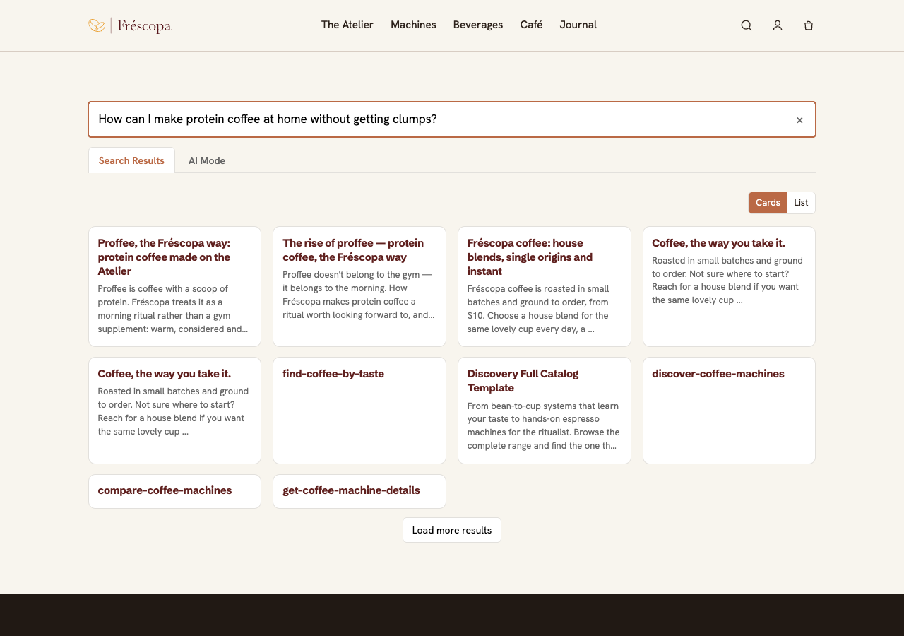

# Content AI Search block

An Edge Delivery Services block that adds an AI-powered search experience to a page, backed by an Adobe Content AI content source.

## See it live

The block runs on the Fréscopa demo site: **https://www.frescopa.coffee/search**

Try a natural-language query such as `How can I make protein coffee at home without getting clumps?`, then switch between the tabs and layouts.



_Screenshot of the live page. The live site is built from `markszulc/frescopa26`, which can be behind this repository's `main`; for example, the text-excerpt fallback for results without a description (below) is not live yet._

## Capabilities

- **Search Results tab**: semantic results from the content source as cards or a list (Cards / List toggle), with a "Searching…" indicator while a query runs and "Load more results" pagination.
- **AI Mode tab**: a generated answer with source links, a loading state and an optional retry on error.
- **Hybrid query**: a vector query combined with a full-text query. The full-text weight shrinks as the query gets longer, so natural-language questions rely mostly on the semantic match. The response is limited to the fields the block displays.
- **Duplicate handling**: duplicate results (same page URL, ignoring trailing slash and fragment) are dropped, and short pages are topped up with follow-up requests.
- **Result text fallbacks**: when a result has no description, a short excerpt of the page text is shown, and skip-link anchors such as `#main-content` are treated as the same page.
- **Defensive decoration**: works with the authored block table, falls back to local mock data (`mock-results.json`, `mock-answer.json`) when no `base-url` is configured.

## Block configuration

Authored as a two-column table in the block. All keys are optional.

| Key | Default | Description |
| --- | --- | --- |
| `base-url` | none (mock data) | Base URL of the proxy that serves `/search` and `/gensearch` |
| `content-source` | none | Name of the Content AI content source |
| `content-source-type` | `AEM_PUBLISH` | Content source type, for example `ACQUISITION` |
| `placeholder` | `Search…` | Search field placeholder |
| `results-size` | `10` (max `50`) | Results per page |
| `results-layout` | `card` | `card` or `list` |
| `ai-search-mode-enabled` | `true` | Set to `false` to hide the AI Mode tab |
| `gen-search-error-retry-visible` | `true` | Set to `false` to hide "Try again" on AI Mode errors |
| `disclaimer-text` | none | Text shown under the generated answer |
| `id` | generated | Element id for the block |

The Content AI API key is never in the browser: the block calls a small proxy at `base-url`, which adds the credentials server-side.

## Environments
- Preview: https://main--content-ai-search-block--Apoorv-R98.aem.page/
- Live: https://main--content-ai-search-block--Apoorv-R98.aem.live/

## Documentation

Before using the aem-boilerplate, we recommand you to go through the documentation on https://www.aem.live/docs/ and more specifically:
1. [Developer Tutorial](https://www.aem.live/developer/tutorial)
2. [The Anatomy of a Project](https://www.aem.live/developer/anatomy-of-a-project)
3. [Web Performance](https://www.aem.live/developer/keeping-it-100)
4. [Markup, Sections, Blocks, and Auto Blocking](https://www.aem.live/developer/markup-sections-blocks)

## Installation

```sh
npm i
```

## Linting

```sh
npm run lint
```

## Local development

1. Create a new repository based on the `aem-boilerplate` template
1. Add the [AEM Code Sync GitHub App](https://github.com/apps/aem-code-sync) to the repository
1. Install the [AEM CLI](https://github.com/adobe/helix-cli): `npm install -g @adobe/aem-cli`
1. Start AEM Proxy: `aem up` (opens your browser at `http://localhost:3000`)
1. Open the `content-ai-search-block` directory in your favorite IDE and start coding :)
